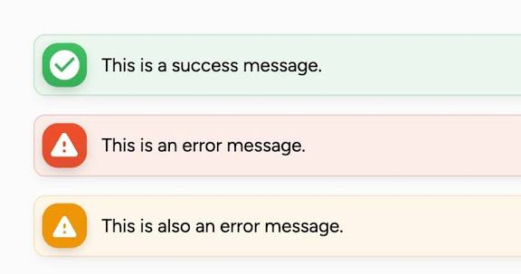

Важные уведомления с действиями:
• Дедлайн через 24 часа До срока работы сутки, а сдачи нет. Срок ДЗ без явного дедлайна — начало следующего занятия - действие: ученик сдал работу. Клик по уведомлению переносит на шаг урока с этой работой
• Дедлайн пропущен Срок прошёл, работа не сдана (сдать её всё равно можно, сдача получит метку «Просрочено») - действие: ученик сдал работу. Клик по уведомлению переносит на шаг урока с этой работой
• Запись на экзамен доступна - действие: ученик записался на экзамен. Клик по уведомлению переводит на экран Мои экзамены

Пример (для важных берём красный цвет)
